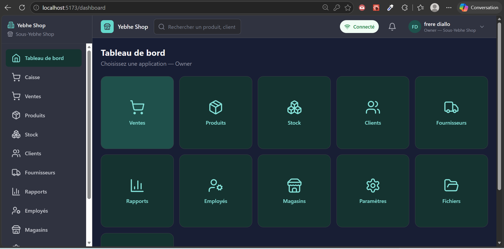
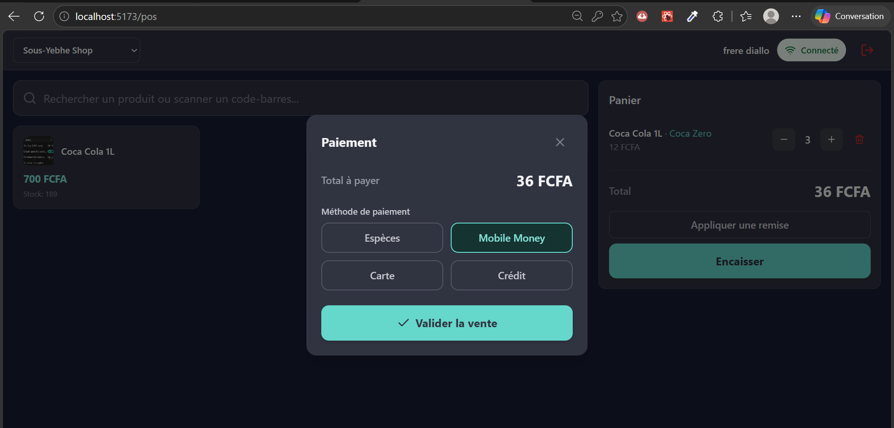
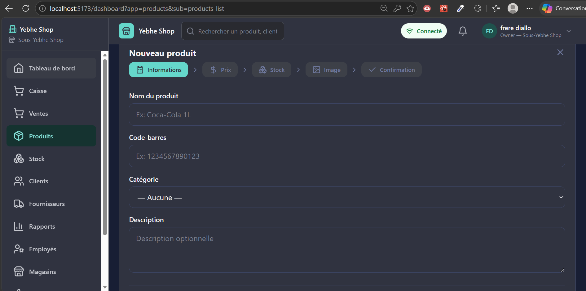
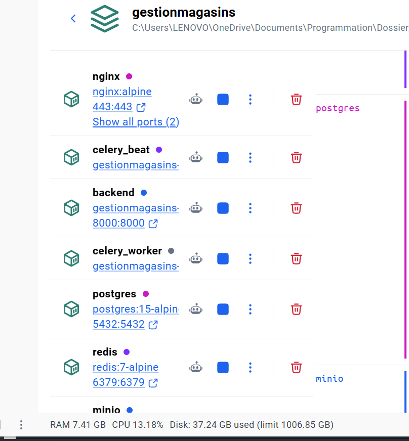
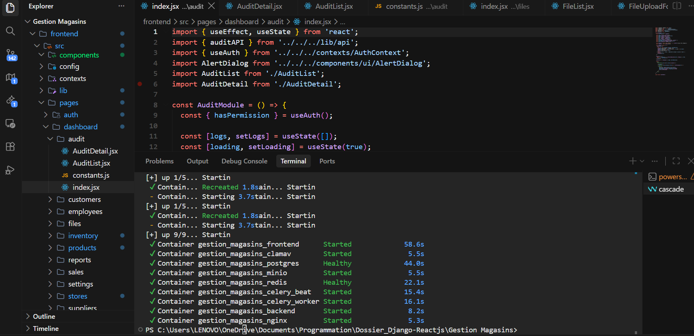
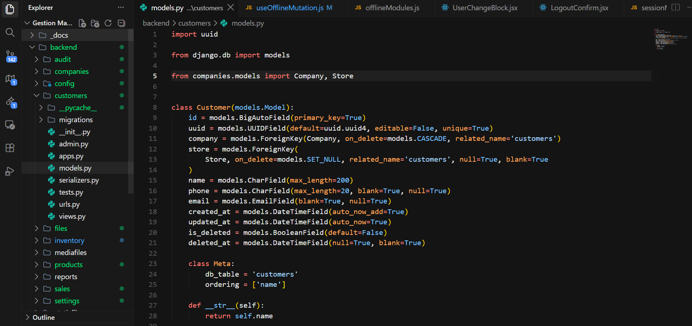

# YEBHE — Gestion Magasins

> SaaS multi-tenant de gestion de magasins : point de vente (POS), stock,
> produits, clients, fournisseurs et rapports — avec **fonctionnement
> complet hors ligne** (PWA + IndexedDB).

[](https://www.djangoproject.com/)
[](https://www.django-rest-framework.org/)
[](https://react.dev/)
[](https://vite.dev/)
[](https://www.postgresql.org/)
[](https://www.docker.com/)
[](https://web.dev/progressive-web-apps/)

---

## Captures d'écran

| Dashboard | Caisse (POS) |
|:---:|:---:|
|  |  |

| Ajout produit | Architecture Docker |
|:---:|:---:|
|  |  |

| Code frontend | Code backend |
|:---:|:---:|
|  |  |

---

## Fonctionnalités

- **Multi-tenant** : plusieurs entreprises, plusieurs magasins, un utilisateur
  peut appartenir à plusieurs entreprises (memberships).
- **Rôles & permissions** : catalogue central de ~80 permissions, rôles
  système (Owner, Admin, Manager, Cashier, Stock Manager, Accountant) +
  rôles personnalisés par entreprise, isolation à 2 niveaux (scope
  `COMPANY` / `STORE`).
- **Point de vente (POS)** : sessions de caisse, panier, contrôle du stock
  disponible, espèces / Mobile Money (Chap Chap Pay) / carte / crédit.
- **Inventaire** : entrées, sorties, ajustements, transferts inter-magasins,
  historique, annulation avec recalcul du stock.
- **Mode hors ligne** : ventes, produits, clients, fournisseurs et stock
  utilisables sans réseau ; synchronisation automatique au retour en ligne
  avec gestion des conflits.
- **Rapports** : ventes, inventaire, export CSV/Excel, graphiques.
- **Fichiers** : upload scanné par ClamAV, stockage S3/MinIO, isolé par tenant.
- **Audit** : journal des actions sensibles (création/annulation de vente,
  mouvements de stock…).
- **Abonnements** : plans SaaS, statuts trial/active/suspended/cancelled.
- **Docs API** : Swagger / Redoc générés par drf-spectacular.

## Stack technique

| Couche | Technologies |
|---|---|
| **Backend** | Python 3.11 · Django 4.2 · Django REST Framework · SimpleJWT · drf-spectacular · django-filter · Celery 5 + django-celery-beat · Pillow · pyclamd · django-storages/boto3 · gunicorn + whitenoise |
| **Frontend** | React 18 · Vite 5 · react-router-dom 6 · TailwindCSS · lucide-react · axios · TanStack Query · react-hook-form + zod · recharts · date-fns |
| **Offline / PWA** | vite-plugin-pwa · Workbox (service worker, runtime caching) · Dexie (IndexedDB) · file de synchronisation custom · sessions locales chiffrées (Web Crypto API) |
| **Data & services** | PostgreSQL 15 · Redis 7 · MinIO (S3) · ClamAV · Nginx (reverse proxy) |
| **Paiement** | Chap Chap Pay (Mobile Money, webhooks) |
| **DevOps** | Docker Compose (9 services) · Nginx · healthchecks |

## Architecture

```
┌──────────┐   ┌──────────────────────────────────────────────┐
│ Navigateur│──▶│ Nginx :80                                    │
└──────────┘   │   /        → frontend (Vite :5173)            │
               │   /api/    → backend (Django :8000)           │
               │   /admin/  → backend                          │
               │   /static/ /media/ → volumes partagés         │
               └──────────────────────────────────────────────┘
        ┌───────────────┬────────────────┬───────────────────┐
        ▼               ▼                ▼                   ▼
   PostgreSQL 15    Redis 7        MinIO (S3)           ClamAV
                          │
                    Celery worker + beat
```

- **Tenant** : résolu via le claim `company_id` du JWT par `TenantMiddleware`
  (jamais via body/header — isolation garantie côté serveur).
- **DB** : 26 tables applicatives — identifiants publics en UUID, `id`
  interne jamais exposé, soft-delete (`is_deleted`) sur les entités métier.

## Mode hors ligne (offline-first)

Module `frontend/src/pwa/` :

- **`db.js`** — base IndexedDB (Dexie) : caches (`products`, `categories`,
  `customers`, `suppliers`, `stores`, `settings`), `syncQueue`,
  `syncLog`, `sales`, `posSessions`, `stockMovements`. Chaque ligne porte
  `company_uuid / store_uuid / user_uuid / device_uuid` (isolation totale).
- **`useOfflineMutation`** — mutations offline-first : UUID généré côté
  client, mise à jour du cache local, mise en file `syncQueue`.
- **`syncManager`** — rejoue la file au retour réseau, gère les conflits
  (409), annule les paires CREATE+DELETE.
- **`sessionManager`** — session locale chiffrée (AES-GCM, clé en
  IndexedDB) pour l'authentification hors ligne.
- **`networkManager`** — détection online/offline (polling `navigator.onLine`
  + test de latence).
- **`applyPendingStock`** — recalcule le stock affiché en intégrant les
  mouvements/ventes en attente.
- **UI** : `SyncStatus`, `PendingOps`, `SyncConflicts`, `SyncOverlay`,
  `LogoutConfirm`, `UserChangeBlock`, `InstallPrompt`, `UpdateBanner`.

Service worker (Workbox) : app shell en `CacheFirst`, routes SPA via
`navigateFallback`, API en `NetworkOnly` avec réponse 503 gracieuse hors
ligne, images/polices en `CacheFirst`.

## Démarrage rapide

```bash
# 1. Vérifier le fichier .env à la racine (DB, MinIO, VITE_API_URL)

# 2. Lancer toute la stack
docker compose up -d

# 3. Migrations + superuser
docker compose exec backend python manage.py migrate
docker compose exec backend python manage.py createsuperuser
```

| URL | Description |
|---|---|
| http://localhost | Application (via Nginx) |
| http://localhost:5173 | Vite dev server (HMR) |
| http://localhost:8000/api/ | API REST |
| http://localhost:8000/api/docs/ | Swagger UI |
| http://localhost:8000/admin/ | Admin Django |
| http://localhost:9001 | Console MinIO |

### Tester le PWA / mode hors ligne

```bash
docker compose -f docker-compose.yml -f docker-compose.pwa-test.yml \
  up -d --no-deps --force-recreate frontend
# → build production servi sur http://localhost
# → DevTools > Network > "Offline" pour tester
```

### Commandes utiles

```bash
docker compose logs -f backend                 # logs API
docker compose exec backend python manage.py test   # tests
docker compose exec backend python manage.py migrate
```

## Structure

```
├── backend/            # Django REST API
│   ├── users/          # auth, rôles, permissions, memberships
│   ├── companies/      # entreprises, magasins
│   ├── products/       # produits, catégories, stock_levels
│   ├── inventory/      # mouvements de stock, transferts
│   ├── customers/      # clients
│   ├── suppliers/      # fournisseurs
│   ├── sales/          # ventes, items, POS sessions, Mobile Money
│   ├── reports/        # rapports & exports
│   ├── settings/       # paramètres entreprise/magasin
│   ├── subscriptions/  # plans & abonnements
│   ├── files/          # uploads scannés (ClamAV) → MinIO
│   ├── audit/          # journal d'audit
│   └── config/         # settings Django, Celery, middlewares
├── frontend/           # React + Vite + PWA
│   └── src/
│       ├── pages/      # dashboard (ventes, produits, stock…) + POS
│       ├── pwa/        # couche offline (sync, cache, session, UI)
│       ├── contexts/   # AuthContext, PWAContext
│       ├── components/ # layout, UI communs
│       └── lib/        # axios API client
├── nginx/              # reverse proxy
├── docker-compose.yml
└── docker-compose.pwa-test.yml
```

## Compétences démontrées

**Backend / API**
- Conception d'une API REST multi-tenant sécurisée (JWT, permissions
  granulaires, middleware de résolution de tenant).
- Architecture RBAC : catalogue de permissions, rôles système +
  personnalisés, scopes `COMPANY`/`STORE`.
- Traitements asynchrones (Celery), tâches planifiées (beat), stockage S3,
  scan antivirus sur uploads, webhooks de paiement.
- Modélisation SQL avancée : soft-delete, contraintes d'unicité,
  PROTECT/CASCADE, transactions métier (vente → stock → audit).

**Frontend**
- SPA React complexe : routing, formulaires validés (react-hook-form +
  zod), data fetching (TanStack Query), graphiques (recharts).
- **PWA offline-first** : IndexedDB/Dexie, file de synchronisation avec
  gestion de conflits, sessions chiffrées (Web Crypto API), Workbox
  (caching strategies), install/update prompt.
- UX accessible : interface pensée pour un public peu à l'aise avec
  l'écrit (grandes icônes, navigation simplifiée).

**DevOps / infra**
- Docker Compose multi-services (9 conteneurs : app, DB, cache, worker,
  stockage, antivirus, proxy).
- Nginx : reverse proxy, routage API/static/media, upstreams.
- Healthchecks, volumes persistants, override compose pour mode PWA-test.

## Documentation interne

Le dossier `_docs/` contient les specs détaillées (rôles, permissions,
PWA, fonctionnement hors ligne) et `RESUME_PROJET.txt` un résumé complet
de l'architecture et des tables.

---

*Projet personnel — démonstration full-stack : Django/DRF + React PWA
offline-first + Docker.*
